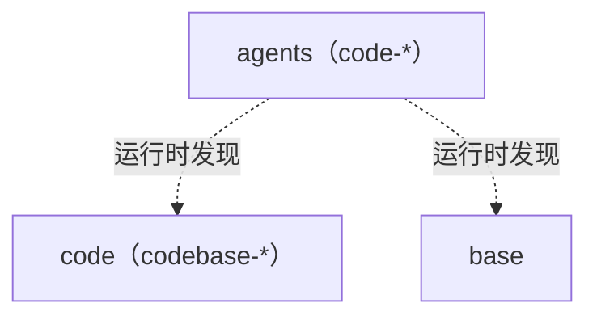

# Skills Architecture

四层技能，单向依赖。术语见 [GLOSSARY.md](GLOSSARY.md)。

## Layers

- `codebase-*` 只引用 `codebase-*` 兄弟技能，不提任何 Role 或 base 技能；"Not for" 只指向兄弟技能。**不装 Role 也能独立执行。**
- 需要子代理的步骤，写明没有子代理时的退路（分轮独立执行）。
- Role 只点名 `self-grilling`（判断力的核心）和它自己产出、维护的东西（如 `observer` 的 `observe-result`），不点名其他 Skill 或 Role，只描述它在意什么；运行时自己发现可用的 Skill。Skill 从不提及 Role。

## Layout

- `skills/base/`：动词、方法论，自身不产出交付物（grilling、self-grilling、handoff、research）
- `skills/code/`：`codebase-*`，名词、工程规范，装进每个项目仓库
- `skills/office/`：`office-*`，名词、办公产物（待建）
- `skills/agents/`：`code-*` 等 Role，以及跨领域的 `observer`，可选安装
- `references/`：外部参考仓库（submodule），只读

## Skill 与 Role 的分工

- **Skill 放方法与标准**：怎么做、做到什么程度。谁拿到都能照着执行。
- **Role 放身份，用描述，不列清单**：一句 Mission（要防的倾向写进这句话里），再用一段话说它在意什么、怎么判断完成、遇到什么会退回。除上面两类例外，不点名 Skill 或其他 Role，这样缺了哪个，它也能自己发现、自己补位。每个 Role 写明：一件事只在一个角色下做，或者不带角色，不能同时带两个；同时加载了多个时，留用户点名的那个，否则留这件事所属的那个；工作转入另一个角色时说出来再切换。Role 不重复 Skill 里的方法；只有它自己用的方法、脚本和模板，随 Role 放在它的 `references/`、`scripts/`、`assets/` 下（如 `observer`）。
- **判断力放在 self-grilling**：在 Mission 下把每个决策追问到最佳实践；Mission 之内自己拍板并在交付时列出，超出 Mission 或难以撤回（One-way door）的交给用户。

## 写法

- **命名**：Skill 用 `<领域>-<一个名词>`（`codebase-verify`）；Role 用 `<领域>-<角色名词>`（`code-builder`），需要时三个词（`code-feature-definer`）；跨领域的 Role 不加前缀（`observer`）。
- **description**：做什么。Use when …。Not for …。
- **写目标与原则，不写死规矩**：目标是标准，做法是推荐；AI 自己知道或推得出的命令、参数、配置不写；项目换了做法，在它的 `docs/ARCHITECTURE.md` 记原因。
- **提问协议**：能查到的事实自己查；只有会改变产出的决策交给用户，一次问清，每个附推荐答案；不默默假设。
- 技能正文用英文，术语按 GLOSSARY。

## 技能里的脚本

技能自带的脚本放在 `scripts/` 下，确定性的事交给脚本，判断留给技能正文。`make check` 会检查下面带 ✓ 的几条。

- ✓ 可执行，首行 `#!/usr/bin/env python3` 或 `#!/usr/bin/env bash`。
- ✓ **Python**：头部有 PEP 723 块（`# /// script`，写 `requires-python = ">=3.15"` 和带最低版本的依赖），模块 docstring 写用途和 `Usage:`，示例一律 `uv run`；通过 `ruff check`。用 3.15 的写法：`lazy import` 延后只在部分路径用到的模块，常量映射用 `frozendict`，推导式里直接 `*` 解包，文件读写依赖默认的 UTF-8 而不再写 `encoding=`。
- ✓ **Bash**：头部注释写 Name、Description、Usage（含 Options、Example、Requires），紧接 `set -euo pipefail`。
- 都要有 `--help`；退出码 0 成功、1 失败；错误写到 stderr。
- 输出统一用 `✓`（成功）和 `✗`（出错，带上下文）。
- 会写东西的脚本提供 `--dry-run`。
- Python：只用绝对导入；捕获具体异常，转换时 `raise ... from e`；参数和返回值写类型；复杂函数写 docstring（说做什么，不说怎么做）。
- Bash：常量 `readonly`，函数变量 `local`，变量加引号，用 `[[ ]]` 和 `$()`。
