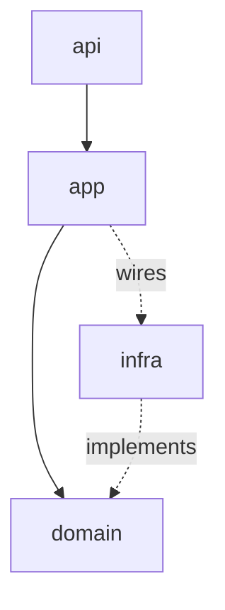

# ARCHITECTURE.md Format

`docs/ARCHITECTURE.md` is the project's conventions, stated as facts: what we build with, where code goes, which way dependencies point, and which seams everything goes through. The domain itself (contexts, terms, how they relate) lives in `docs/GLOSSARY.md`; this file references it and never redefines it. It's what a human or an agent reads to work in this project without breaking its shape.

Create it lazily: only when the first convention worth recording is settled. Add each section only when it has something to say.

## Structure

````md
# {Project Name} Architecture

{One or two sentences: the system's overall shape.}

## Stack

**Database**: Postgres
_Avoid_: MongoDB, ORMs

**Messaging**: in-process domain events

## Layout

- `src/{context}/`: one folder per context; nothing reaches into another context's folder
- `src/{context}/domain/`: entities and rules; no I/O
- `src/{context}/infra/`: adapters for the database, HTTP, queues
- `src/shared/`: types used by two or more contexts; never logic

## Layers


````

- `domain` imports nothing outside itself
- Cross-context calls go through the other context's `app`, never its `domain` or `infra`
- Contexts talk via domain events; no shared tables

## Seams

**PaymentGateway** (`billing/domain`): hides the payment provider; the only place provider SDKs are imported
_Adapters_: Stripe, in-memory

**Clock**: all time reads go through it
_Adapters_: system clock, fixed clock

```

## Rules

- **State facts, not history.** Write the convention as it stands today. No "we decided", no "because", no alternatives considered. If the convention changes, rewrite the line; don't append.
- **Be prescriptive.** Write rules, not descriptions. "`domain` imports nothing outside itself" is a convention; "we have a domain folder" is a directory listing.
- **Be opinionated.** When the obvious choice is off-limits, list it under `_Avoid_`, the same way the glossary does for words.
- **Only include what's specific to this project.** General best practices (SOLID, "keep functions small", "write tests") don't belong. Before adding a line, ask: would a new contributor who already knows the stack put code in the wrong place or pick the wrong tool without it? Only then does it belong.
- **Reference the glossary, don't repeat it.** Contexts, aggregates, and events are named exactly as in `docs/GLOSSARY.md`, never redefined here. If the right word doesn't exist yet, resolve it in the glossary first.
- **Use the design vocabulary.** Module, interface, seam, adapter, depth: exactly as the `codebase-design` skill defines them. Don't drift into "component", "service", or "boundary". A seam listed here has at least two adapters; one adapter is indirection, not a seam.
- **Draw the layers.** Show dependency direction as a Mermaid diagram; list only the rules the arrows can't express.
- **Stay at module altitude.** Folders, layers, contexts, and seams. No function names, config values, or step-by-step flows: the code is the source of truth for those.
- **Keep it true.** A conventions doc describing a system that no longer exists is worse than none. When the code and the doc disagree, surface it and fix whichever is wrong in the same session.
```
